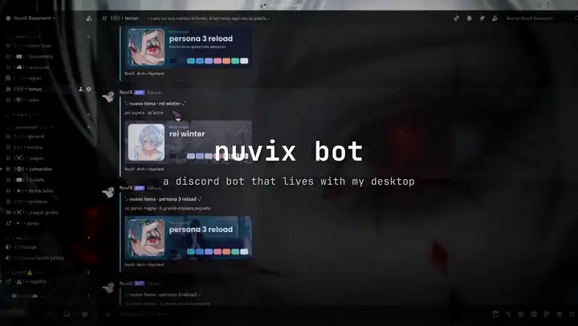
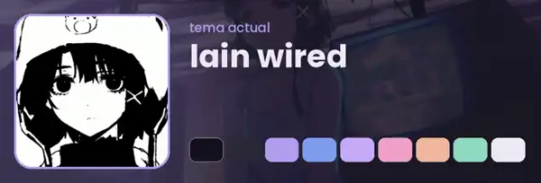
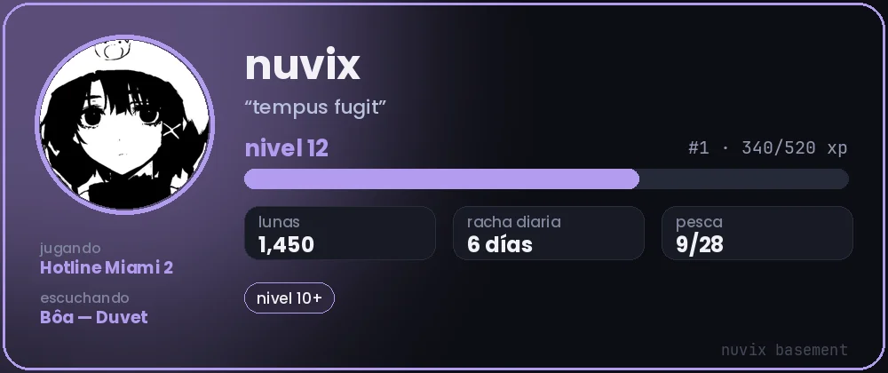
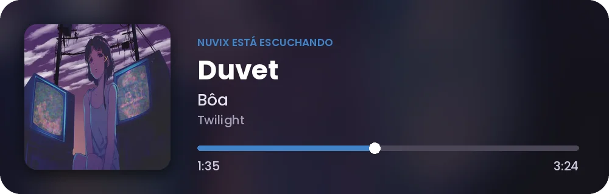
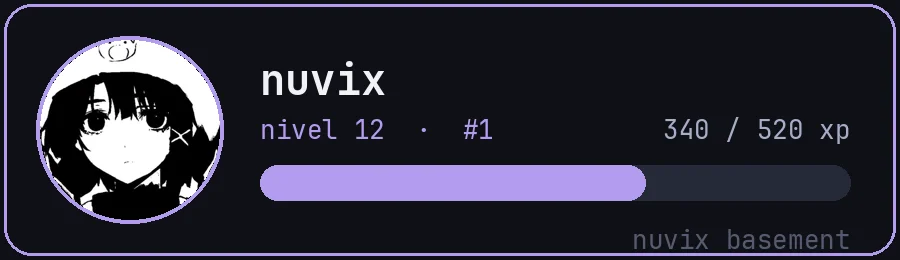

<p align="center">
  <a href="https://nuvix16.github.io/Bot-NuviX/"></a>
</p>

<p align="center">
  
  
  
  
  
</p>

<p align="center"></p>

## ✨ Qué hace

| | |
|---|---|
| 🏠 **Comunidad** | entrada con botón, roles, encuestas, planes, tickets, citas, destacados y concurso semanal |
| ☾ **Niveles y lunas** | XP por hablar, economía propia, misiones diarias, tienda de colores, `/perfil` |
| 🎣 **Para pasar el rato** | pesca con 28 especies, lotería semanal, cumpleaños, `/spotify` |
| 🔔 **Avisos** | anime (AniList), manga (MangaUpdates), ofertas (CheapShark), juegos gratis, Twitch y YouTube |
| 🖥️ **El escritorio** | `/rice`, `/tema`, `/nowplaying` y control remoto `/pc` de mi laptop |
| 📅 **Mi día** | tareas, horario, bitácora de la estadía, banco de ideas y resumen diario con clima |
| 🛡️ **Moderación** | AutoMod contra spam, registro privado y límites por persona |

## 🎨 Sigue al escritorio

Un agente en mi laptop reporta el tema del escritorio. Cuando cambio de fondo, el bot cambia de avatar, el servidor de ícono, mi rol de color y llega una tarjeta animada con la paleta nueva.

<p align="center"></p>

## 🃏 Tarjetas

<p align="center">
  
  
</p>
<p align="center"></p>

## ⚙️ Cómo está armado

```
laptop (Arch)                         Google Cloud e2-micro
agente_pc.py  ──►  canal privado  ◄──  bot.py + 26 módulos
tema, música, salud      estado / pedidos       comandos, botones, tareas programadas
                                                Uptime Kuma · ntfy · respaldo cifrado
```

<p align="center">
  <a href="https://skillicons.dev"></a>
</p>

<sub>Este repo es solo la página; el código vive en un repo privado porque incluye la configuración del servidor.</sub>


